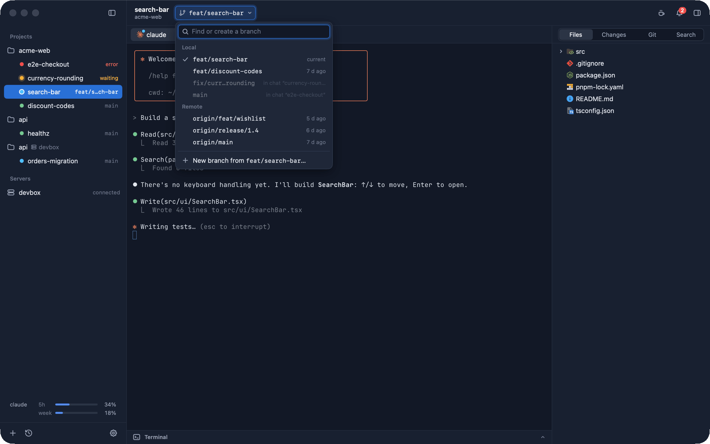
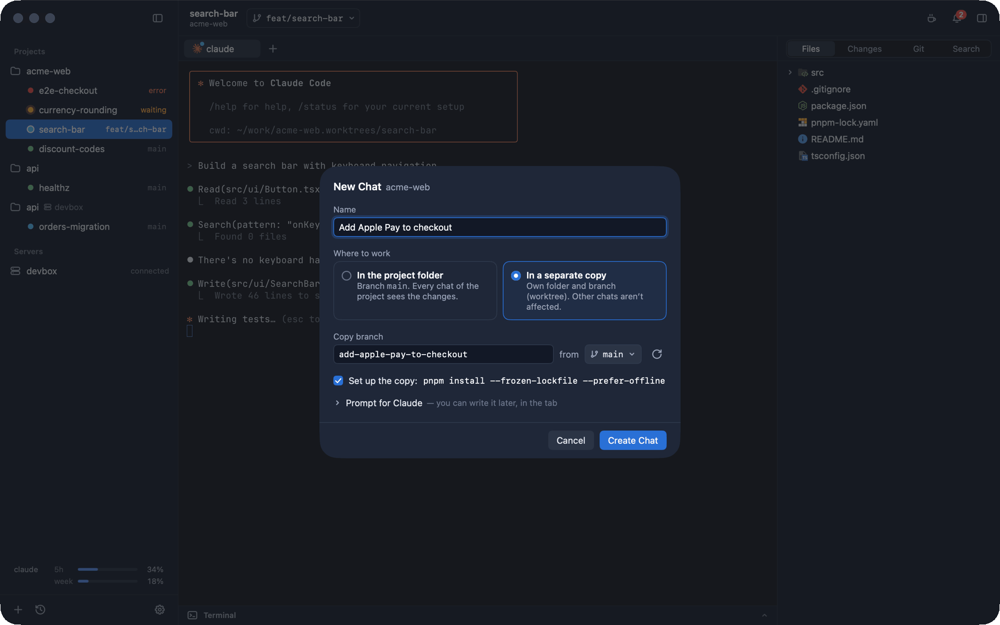
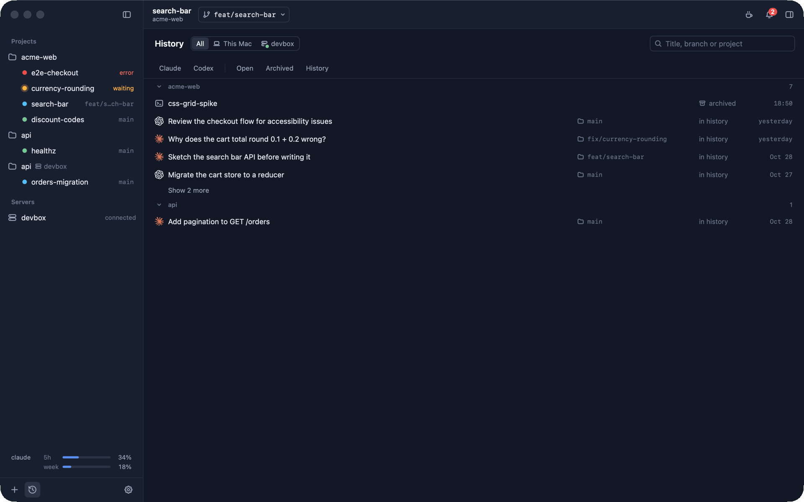
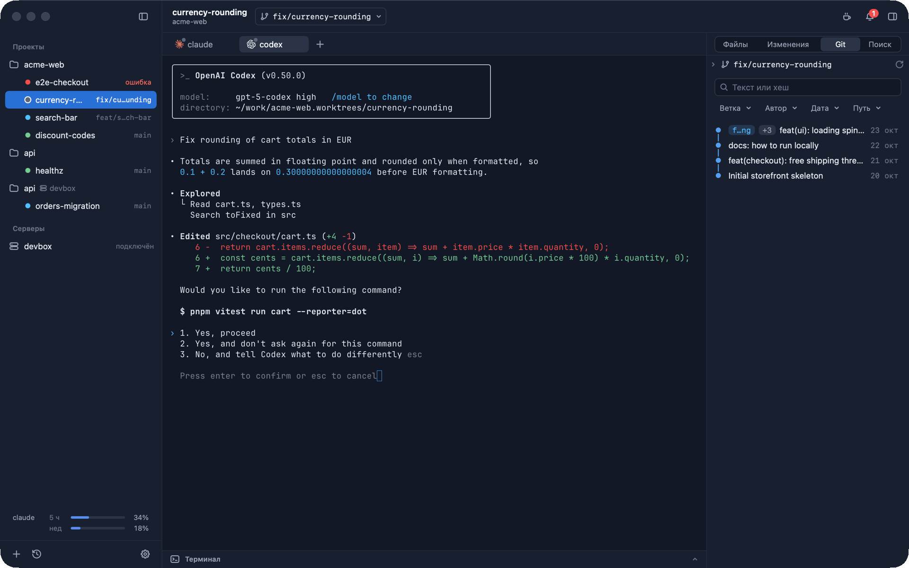

<div align="center">


# Hangar

A native macOS app for running Claude Code and Codex side by side: one chat per piece of work, each in Ghostty terminal tabs, with its branch, changes, Git history and an editor next to it.

[](https://github.com/kirillonishuk/hangar/releases/latest)
[](https://github.com/kirillonishuk/hangar/actions/workflows/ci.yml)
[](#install)
[](LICENSE)

<a href="docs/assets/hangar-demo.mp4">
  
</a>

</div>

## What it is

Hangar is a workspace for coding agents. You add projects (local folders or folders on an SSH server); each project holds chats. A chat is one piece of work for one or more agents: its own terminal tabs and splits, and either the project folder or a separate copy of it (a git worktree on its own branch). The sidebar shows every chat with its state, so you can run several agents at once and see which one needs you.

It is a Swift/AppKit app, not Electron. Terminals are [libghostty](https://github.com/ghostty-org/ghostty) and use your Ghostty config. Hangar does not replace the agents: it runs the `claude` and `codex` you already have.

## Screenshots

<table>
  <tr>
    <td width="50%"><br><sub>Chats and their states, Claude's status line, Changes</sub></td>
    <td width="50%"><br><sub>Branch switcher in the toolbar</sub></td>
  </tr>
  <tr>
    <td><br><sub>New Chat: project folder or a separate copy</sub></td>
    <td><br><sub>History (⌘Y)</sub></td>
  </tr>
  <tr>
    <td><br><sub>Diff, VS Code Dark+ theme</sub></td>
    <td><br><sub>A project on an SSH server, Git tab</sub></td>
  </tr>
  <tr>
    <td><br><sub>Settings → Appearance</sub></td>
    <td><br><sub>Russian UI, a Codex chat waiting for approval</sub></td>
  </tr>
</table>

## Features

- **Chats.** One row per chat in the sidebar, grouped under Projects and Servers. A chat works in the project folder or in a separate copy (a git worktree with its own branch, created next to the project, not inside it), optionally prepared with `pnpm install` / `yarn` / `bun`.
- **Agent states.** Working, waiting, done, error and at-limit, from Claude Code and Codex hooks: a dot in the sidebar, a word when a chat needs you, the bell's inbox, the Dock badge and notifications.
- **Branch in the toolbar.** Each chat shows its live branch. The switcher checks out a local or remote branch or creates a new one, and refuses when uncommitted changes or ignored files would be lost.
- **Inspector.** Files, Changes (not committed or the whole branch), Git (branches, graph, history with filters) and Search in files.
- **Editor and diff.** [Monaco](https://github.com/microsoft/monaco-editor), side-by-side or inline diff. TypeScript/JavaScript go to definition, references, hover and rename via the project's `tsserver`; Python, Swift, Go and Rust via `pyright`/`pylsp`, `sourcekit-lsp`, `gopls`, `rust-analyzer` when installed.
- **History (⌘Y).** Closed chats and past Claude and Codex conversations, searchable, with Continue.
- **Restore.** After a restart every chat reopens its tabs, splits and its own agent conversation (by id, never "the latest one in this folder").
- **SSH servers.** Remote projects run in `tmux` on the host and survive disconnects; statuses and limits come back over the SSH connection.
- **Usage limits.** Claude and Codex subscription limits (5 hours and week) in the sidebar.
- **Claude status line.** Hangar's own line under Claude's prompt: model, context, 5-hour and weekly limits, optionally branch and effort; or keep yours.
- **Appearance.** Hangar Navy, VS Code Dark+ and Graphite; each theme brings a matching editor theme, which you can customise color by color.
- **Quick open (⌘P), command palette (⇧⌘P),** `hangar` CLI and MCP server.
- English and Russian UI (follows the system by default). Shortcuts work in any keyboard layout.

## Install

Requires macOS 14 or later on Apple silicon (the app is arm64-only).

1. Download `Hangar-x.y.z.dmg` from [Releases](https://github.com/kirillonishuk/hangar/releases/latest) and drag Hangar to Applications.
2. The app is ad-hoc signed, not notarized. Allow the first launch with right-click → Open, or:

   ```sh
   xattr -dr com.apple.quarantine /Applications/Hangar.app
   ```

Hangar checks GitHub Releases once a day and shows «Update to X» in the toolbar: one click downloads the DMG, verifies its SHA-256 and replaces the app (Settings → General).

Install [Claude Code](https://docs.anthropic.com/en/docs/claude-code) and/or [Codex CLI](https://github.com/openai/codex) separately.

## Integrations

The first time an agent tab starts, Hangar asks once whether to connect to that agent and shows the exact diff of what it will write. Settings → Integrations has a switch per function:

| Agent | What Hangar adds | Gives you |
|---|---|---|
| Claude Code | hooks in `~/.claude/settings.json` | working / waiting / done / error states, inbox and notifications |
| Claude Code | a `statusLine` wrapper | usage limits in the sidebar, Hangar's status line (or your own line, unchanged) |
| Codex | `notify` in `~/.codex/config.toml` | done state and notifications |
| both | the `hangar` MCP server (`claude mcp add` / `codex mcp add`) | agents can list chats, open tabs and read them |

Changes are additive: Hangar only adds and removes its own entries, leaves yours as they are, refuses to write a file that changed under it, and keeps a backup of the previous file. The same functions are applied on SSH servers you connect (via a small `~/.hangar/bin/hangar-remote` script); MCP is registered on this Mac only.

## Keyboard shortcuts

| Keys | Action |
|---|---|
| ⌘N | New chat |
| ⇧⌘N | Add project |
| ⌘T / ⌘W | New tab / close tab (in a split: the focused pane) |
| ⇧⌘W | Archive chat |
| ⌘D / ⇧⌘D | Split right / split down |
| ⌥⌘← → ↑ ↓ | Focus the split pane on that side |
| ⌘1 … ⌘9 | Go to tab 1…9 |
| ⌃Tab / ⌃⇧Tab | Next / previous tab |
| ⇧⌘] / ⇧⌘[ | Next / previous chat |
| ⌥⌘A | Go to the next chat that is waiting |
| ⌥⌘F | Show waiting chats only |
| ⌘J | Toggle the terminal drawer |
| ⌘0 | Toggle sidebar |
| ⌥⌘I | Toggle inspector |
| ⌥⌘1 / ⌥⌘2 / ⌥⌘3 | Files / Changes / Git |
| ⇧⌘F | Find in files |
| ⌘P | Go to chat or file |
| ⇧⌘P | Command palette |
| ⌘Y | History |
| ⇧⌘L | Subscription limits |
| ⌥⌘R / ⌥⌘C | Reveal in Finder / copy path |
| F2 | Rename |
| ⌘, | Settings |

## CLI and MCP

The `hangar` CLI ships at `Hangar.app/Contents/Helpers/hangar` and talks to the running app over a local socket.

```sh
hangar sessions create --project acme-web --name discount-codes --worktree --prompt "Add a discount code field"
hangar tabs read --tab <id> --lines 40
hangar doctor
```

A chat is a `session` in the CLI and MCP (`hangar sessions …`, `sessions_list`); those names are the API and stay. `hangar mcp` runs the MCP server over stdio (`--read-only` for the safe subset). Destructive calls require `--yes` / `yes: true`.

## Build from source

Requires an Apple silicon Mac, Xcode 26 with the Metal toolchain (`xcodebuild -downloadComponent MetalToolchain`) and Zig 0.15 (`brew install zig@0.15` or [ziglang.org](https://ziglang.org/download/); only needed to build GhosttyKit, which is not in the repository).

```sh
git clone https://github.com/kirillonishuk/hangar.git && cd hangar
scripts/build-ghosttykit.sh   # vendor/GhosttyKit.xcframework at vendor/GHOSTTY_COMMIT
swift build && swift test
scripts/bundle.sh             # build/Hangar.app (release, ad-hoc signed)
scripts/make-dmg.sh           # build/Hangar.dmg
```

If Zig fails to link its build runner against the macOS 26 SDK, build GhosttyKit with Xcode 16 selected (`sudo xcode-select -s /Applications/Xcode_16.app`), as CI does, then switch back.

`swift run HangarApp` starts a debug build; `HANGAR_STATE_DIR` and `HANGAR_CONFIG` point it at separate state. Each PR merged into `main` publishes a release ([`release.yml`](.github/workflows/release.yml)).

## Credits

- [Ghostty](https://github.com/ghostty-org/ghostty) by Mitchell Hashimoto and contributors (libghostty / GhosttyKit), MIT: terminal emulation and rendering.
- [Monaco Editor](https://github.com/microsoft/monaco-editor) 0.57.0, MIT: editor and diff view. Vendored in `Sources/HangarUI/Monaco` with its license and third-party notices.
- [TypeScript](https://github.com/microsoft/TypeScript) `tsserver`, Apache-2.0, and the language servers above: run from your project or `PATH`, not bundled.
- [Icons – Maintained](https://github.com/yusifaliyevpro/vscode-icons) by Yusif Aliyev, a fork of "Icons" by Mhammed Talhaouy, MIT: file icons. Vendored in `Sources/HangarUI/FileIcons`.
- [tmux](https://github.com/tmux/tmux) on SSH servers (not bundled).
- Simplicity rules in `AGENTS.md` are adapted from ponytail by DietrichGebert (MIT).

## License

[MIT](LICENSE) © Kirill Onishuk
