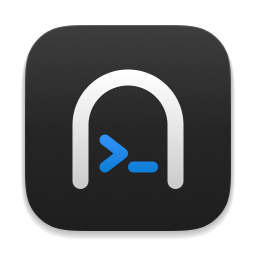
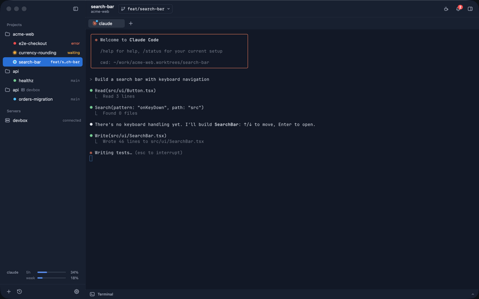
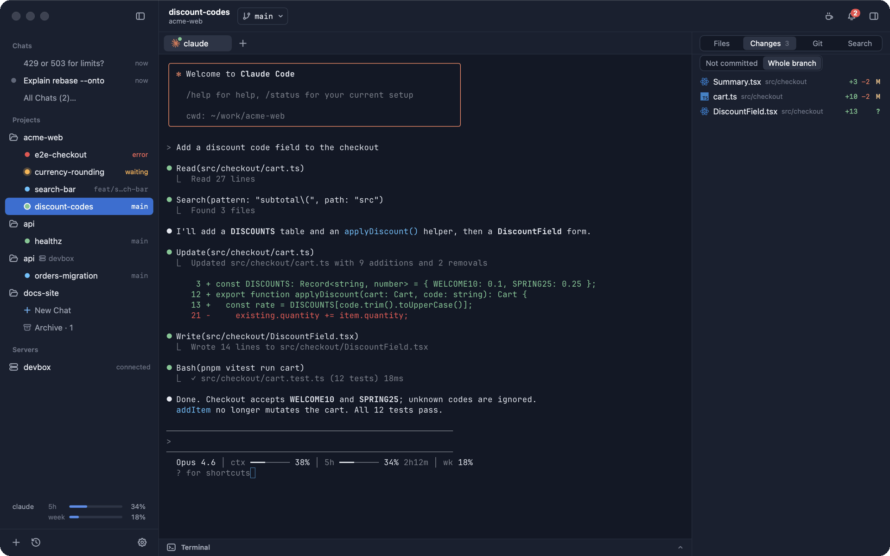
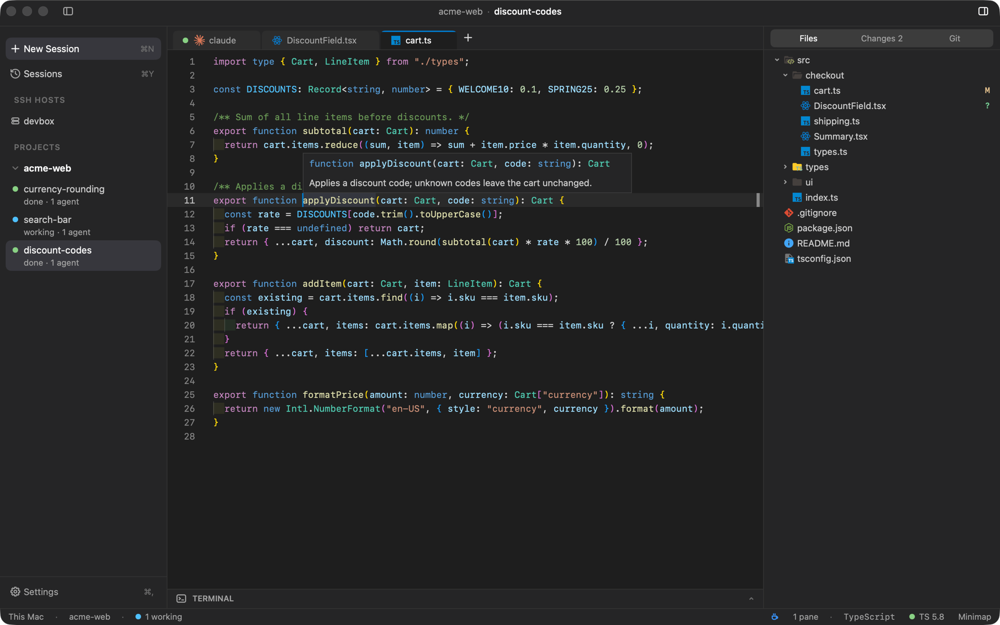
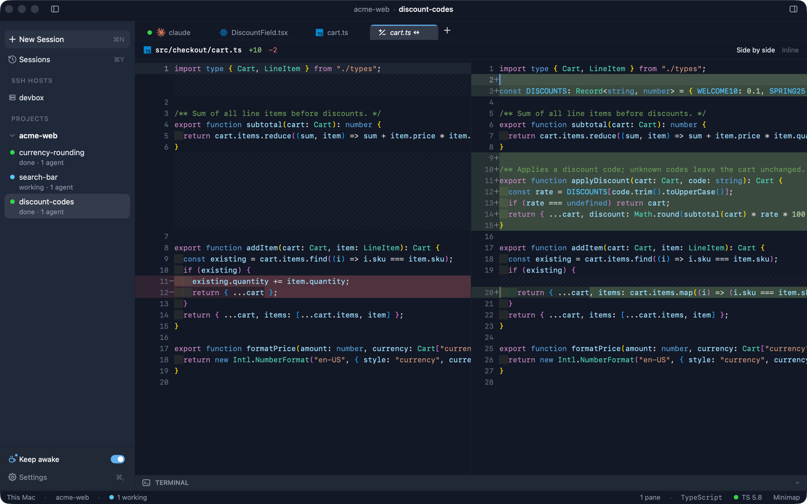
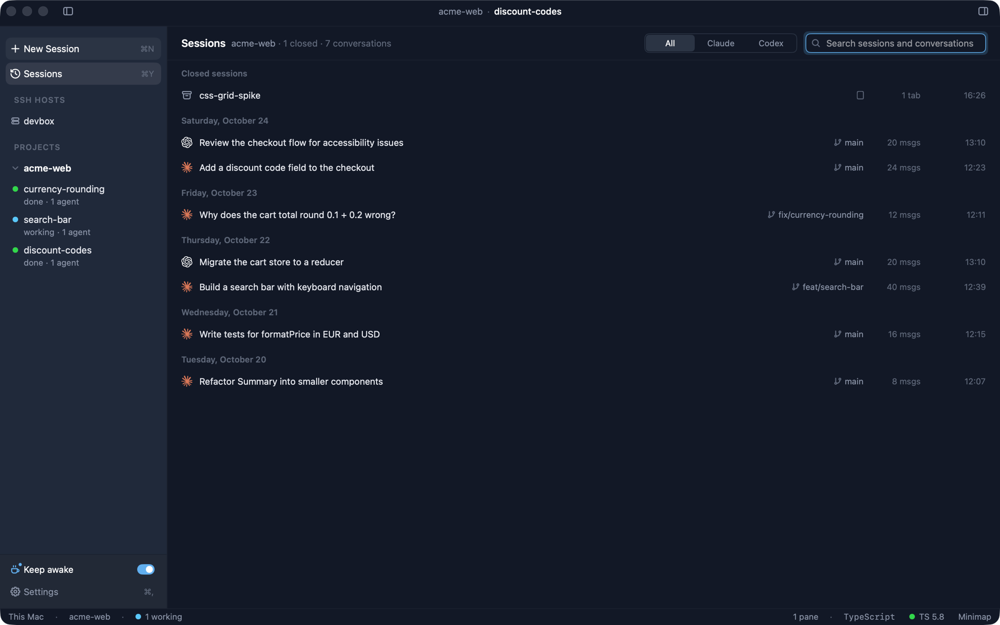
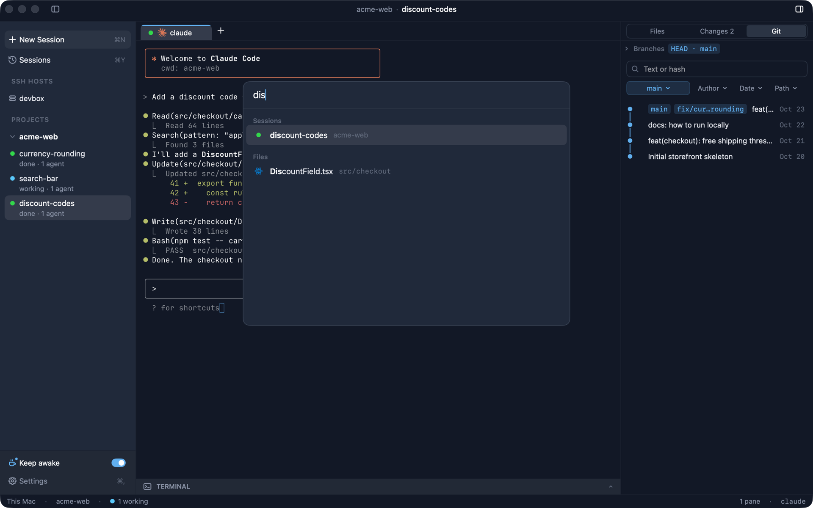
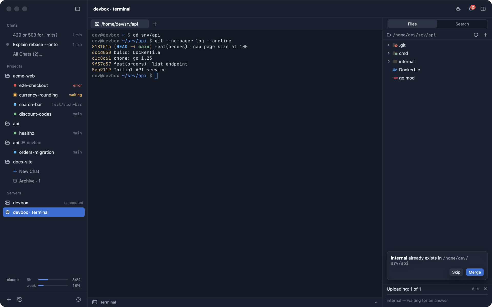
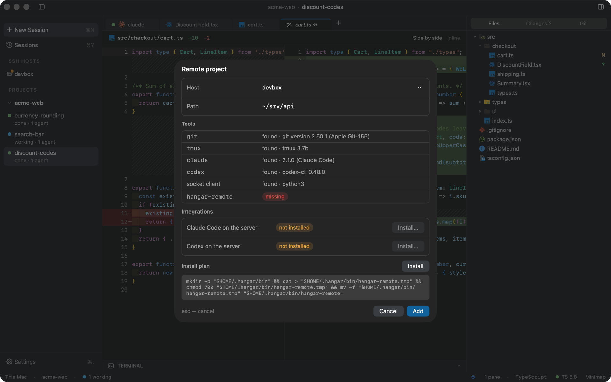
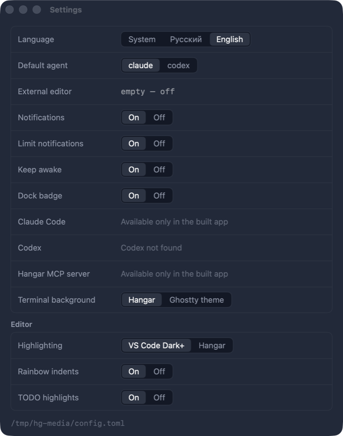

<div align="center">



# Hangar

A native macOS app for running Claude Code and Codex in terminal tabs, one session per task, with Git, diffs and an editor alongside.

[](https://github.com/kirillonishuk/hangar/releases/latest)
[](https://github.com/kirillonishuk/hangar/actions/workflows/ci.yml)
[](#install)
[](LICENSE)

<a href="docs/assets/hangar-demo.mp4">
  
</a>

</div>

## Features

- Projects contain sessions, sessions contain tabs and splits. A session can use its own git worktree and branch.
- Terminal tabs are [libghostty](https://github.com/ghostty-org/ghostty) surfaces and use your Ghostty config.
- Agent status (working, waiting, done, error) from Claude Code and Codex hooks, shown in the sidebar and Dock, with notifications.
- Claude and Codex subscription usage limits in the sidebar.
- Inspector: file tree, changes against the base branch or uncommitted, Git branches and history.
- Monaco editor and diff view (side by side or inline). TypeScript/JavaScript go to definition, references, hover, rename and diagnostics via the project's `tsserver`.
- Sessions view (⌘Y): closed sessions and past Claude/Codex conversations, searchable and resumable.
- Quick open (⌘P) and command palette (⇧⌘P).
- Remote projects over SSH; tabs run in `tmux` on the host and survive disconnects.
- Sessions, tabs, splits and agent conversations are restored after restart.
- `hangar` CLI and MCP server.
- UI language: English or Russian (follows the system by default).

## Screenshots

<table>
  <tr>
    <td width="50%"><br><sub>Sessions and the Git tab</sub></td>
    <td width="50%"><br><sub>Go to definition (tsserver)</sub></td>
  </tr>
  <tr>
    <td><br><sub>Diff</sub></td>
    <td><br><sub>Sessions view</sub></td>
  </tr>
  <tr>
    <td><br><sub>Quick open</sub></td>
    <td><br><sub>Remote project over SSH</sub></td>
  </tr>
  <tr>
    <td><br><sub>Remote host check</sub></td>
    <td align="center"><br><sub>Settings → Appearance (also <code>~/.config/hangar/config.toml</code>)</sub></td>
  </tr>
</table>

## Install

Requires macOS 14 or later on Apple silicon (Intel Macs are not supported: the app is arm64-only).

1. Download `Hangar-x.y.z.dmg` from [Releases](https://github.com/kirillonishuk/hangar/releases/latest) and drag Hangar to Applications.
2. The app is ad-hoc signed, not notarized. Allow the first launch with right-click → Open, or:

   ```sh
   xattr -dr com.apple.quarantine /Applications/Hangar.app
   ```

Hangar checks GitHub Releases once a day and offers updates in the status bar: one click downloads the DMG, verifies its SHA-256 and replaces the app in place (Settings → General → Check for updates).

Install [Claude Code](https://docs.anthropic.com/en/docs/claude-code) and/or [Codex CLI](https://github.com/openai/codex) separately. For agent status, install the hooks from Settings; Hangar shows the change to `~/.claude` / `~/.codex` and applies it only after you confirm.

## Build from source

Requires an Apple silicon Mac, Xcode 26 with the Metal toolchain (`xcodebuild -downloadComponent MetalToolchain`) and Zig 0.15 (`brew install zig@0.15` or [ziglang.org](https://ziglang.org/download/); only needed to build GhosttyKit, which is not in the repository).

```sh
git clone https://github.com/kirillonishuk/hangar.git && cd hangar
scripts/build-ghosttykit.sh   # vendor/GhosttyKit.xcframework at vendor/GHOSTTY_COMMIT; Zig from $ZIG, Homebrew's zig@0.15 or PATH
swift build && swift test
scripts/bundle.sh             # build/Hangar.app (release, ad-hoc signed)
scripts/make-dmg.sh           # build/Hangar.dmg
```

If Zig fails to link its build runner against the macOS 26 SDK, build GhosttyKit with Xcode 16 selected (`sudo xcode-select -s /Applications/Xcode_16.app`), as CI does, then switch back for `swift build`.

`swift run HangarApp` starts a debug build. `HANGAR_STATE_DIR` and `HANGAR_CONFIG` point it at separate state.

## CLI and MCP

The `hangar` CLI ships at `Hangar.app/Contents/Helpers/hangar` and talks to the running app over a local socket.

```sh
hangar sessions create --project acme-web --name discount-codes --worktree --prompt "Add a discount code field"
hangar tabs read --tab <id> --lines 40
hangar doctor
```

`hangar mcp` runs an MCP server over stdio (`--read-only` for the safe subset). Destructive calls require `--yes` / `yes: true`.

Settings → Integrations shows these commands with the path of your copy of the app, quoted:

```sh
claude mcp add --scope user hangar -- /Applications/Hangar.app/Contents/Helpers/hangar mcp
codex mcp add hangar -- /Applications/Hangar.app/Contents/Helpers/hangar mcp
```

## Releases

Each PR merged into `main` publishes a release (DMG, SHA-256, demo video). The version is `CFBundleShortVersionString` from `Resources/Info.plist` if the PR raised it above the last tag; otherwise the last `vX.Y.Z` tag is bumped by the PR label `major`/`minor`/`patch`, or by the conventional-commit title (`type!:` major, `feat:` minor, anything else patch). See [`.github/workflows/release.yml`](.github/workflows/release.yml).

## Acknowledgements

- [Ghostty](https://github.com/ghostty-org/ghostty) (libghostty / GhosttyKit), MIT: terminal emulation and rendering.
- [Monaco Editor](https://github.com/microsoft/monaco-editor) 0.57.0, MIT: editor and diff view. Vendored in `Sources/HangarUI/Monaco` with its license and third-party notices.
- [TypeScript](https://github.com/microsoft/TypeScript) `tsserver`, Apache-2.0: language features, run from the user's project (not bundled).
- [Icons – Maintained](https://github.com/yusifaliyevpro/vscode-icons) by Yusif Aliyev, a fork of "Icons" by Mhammed Talhaouy, MIT: file icons. Vendored in `Sources/HangarUI/FileIcons`.
- Simplicity rules in `AGENTS.md` are adapted from ponytail by DietrichGebert (MIT).

## License

[MIT](LICENSE) © Kirill Onishuk
